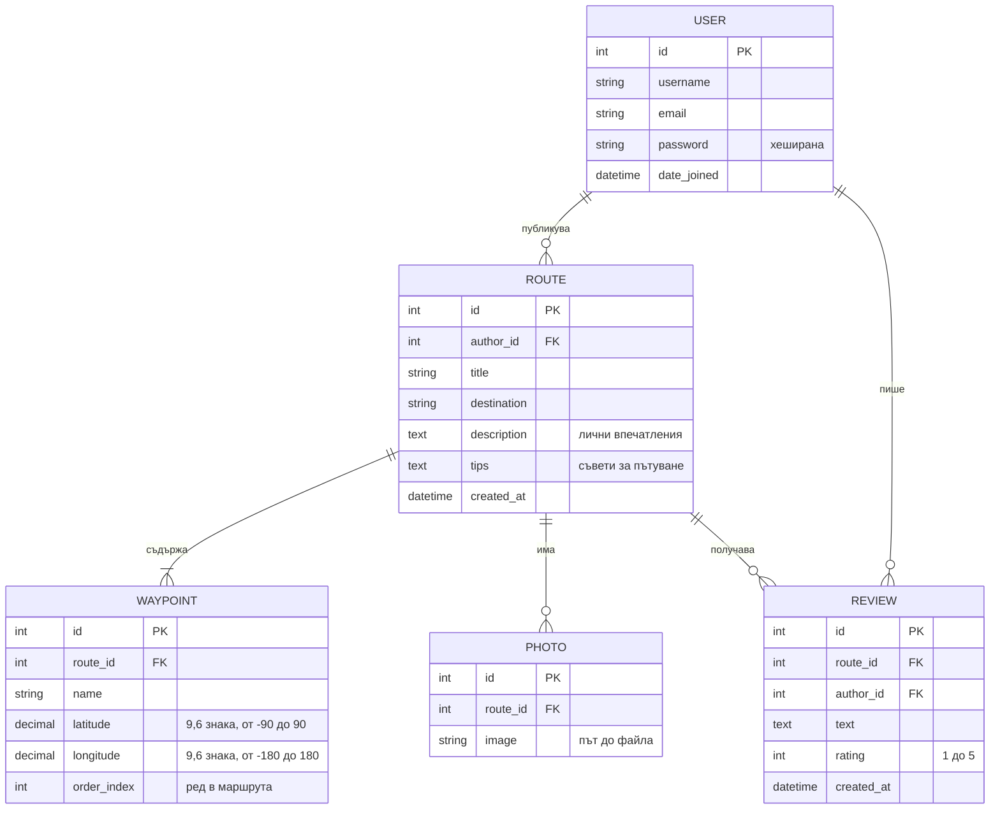

# ER диаграма

## Ограничения
- Един потребител може да остави **само един отзив** на маршрут (уникална двойка `route`, `author`).
- Автор на маршрут не може да оценява собствения си маршрут (проверка в API-то).
- При изтриване на маршрут се изтриват каскадно точките, снимките и отзивите му.
- Географските координати се пазят като десетични числа с 6 знака след запетаята (около 0,1 м точност), по една точка на ред.